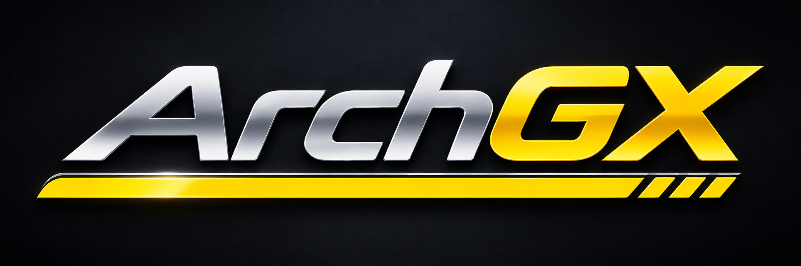
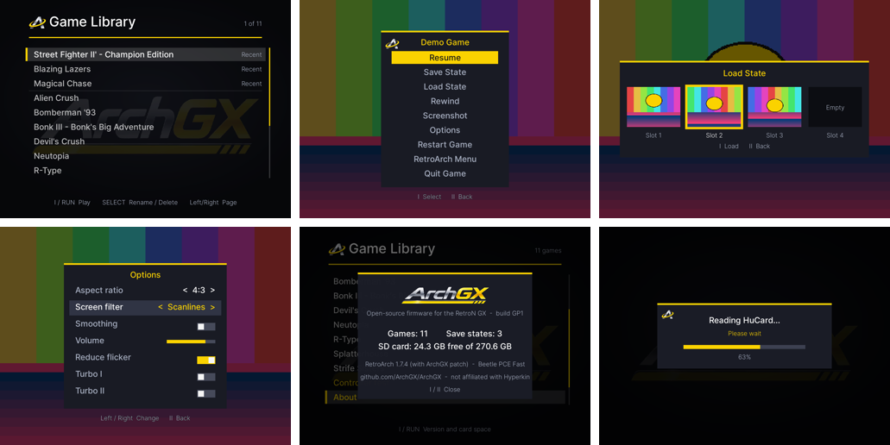

<p align="center">
  
</p>

<p align="center"><b>Open-source firmware for the Hyperkin RetroN GX.</b><br>
Insert a HuCard and play. Save, rewind and resume from a console-style menu.</p>

---

ArchGX replaces the RetroN GX's game launcher, menus and HuCard handling with open-source software. It keeps the console's own boot chain, kernel and graphics drivers, so games still run at full speed on the GPU.

It is installed by a script that patches **your own** SD card. ArchGX doesn't contain or distribute any Hyperkin or Rockchip files.

> **Status: GP1, the first public build.** It has been tested on one console with many HuCards and SD-card games, and every report helps. Read [Install](docs/INSTALL.md) first, and **back up your card**.



## Features

**Library**
- Every game you've played or copied to the card, by name, with the last five played at the top.
- Rename and delete games.

**HuCards**
- Insert a cart and it's read, cleaned up, identified and played.
- Unknown carts (homebrew, repros) work too; name them on the console.
- Each cart is kept in the library, so it's only read once.

**In-game menu** (hold RUN + SELECT)
- Resume, Save and Load State (4 slots with pictures), Rewind, Screenshot, Options, Restart, RetroArch Menu, Quit.

**Rewind**
- A snapshot every 10 seconds, the last two minutes kept as pictures.
- Jump back with one button.

**Options**
- Aspect ratio 4:3 / 16:9 (the front switch also works, live).
- Screen filter: Scanlines or Composite TV.
- Smoothing, volume, reduce sprite flicker, turbo for I and II.

**Resume**
- "Resume last save" or "Start new game" when you pick a game.

**Extras**
- Controller test.
- About screen.
- Progress screens while a cart is read.
- Automatic recovery if the display system crashes.

**Under the hood**
- RetroArch 1.7.4 built from source with a small documented patch.
- The console's Beetle PCE Fast core.
- Everything runs on Mali GPU acceleration, as stock.

## Install

You need:
- the RetroN GX's own SD card (stock firmware `RubyMain-20250709`);
- a PC with Linux or Windows (WSL);
- an SD card reader.

```sh
tar xzf archgx-GP1.tar.gz && cd archgx-GP1
sudo ./installer/archgx-install.sh check   /dev/sdX     # is this card supported?
sudo ./installer/archgx-install.sh install /dev/sdX
```

The installer:
- checks the card first and refuses anything that isn't the supported stock system;
- saves a backup of the original system partition;
- leaves your games and saves alone.

`restore` puts the stock system back. Full instructions, including Windows, are in **[docs/INSTALL.md](docs/INSTALL.md)**.

## Documentation

| | |
|---|---|
| [Install](docs/INSTALL.md) | Back up, install, update, uninstall, troubleshooting |
| [User guide](docs/USER_GUIDE.md) | Every screen and button, the card layout, logs |
| [Building](docs/BUILDING.md) | Build every binary from source |
| [Architecture](docs/ARCHITECTURE.md) | How ArchGX fits into the console, the RetroArch patch |
| [Game database](docs/GAMEDB.md) | How carts are identified; adding unknown games |
| [Changelog](CHANGELOG.md) · [Roadmap](ROADMAP.md) | What changed, what's next |
| [Third-party notices](THIRD_PARTY.md) | Upstream components and their licences |

## Contributing

- **Unknown HuCard?** Name it on the console, then share the line it adds to `gamedb-local.csv` (see [Game database](docs/GAMEDB.md)).
- **Bugs:** open an issue with the files from the card's `logs/` folder.
- **Code:** pull requests welcome. Please keep the "Easy Console" goal in mind: simple on the surface, with RetroArch still there for advanced users.

## Licence and legal

ArchGX is free software under the **GNU General Public License v3** ([LICENSE](LICENSE)). Its RetroArch build is GPLv3 as well; sources and patch are in this repository ([THIRD_PARTY.md](THIRD_PARTY.md)).

ArchGX is an independent project. It is **not affiliated with, endorsed by or supported by Hyperkin**. "RetroN" and "Hyperkin" are trademarks of their owners; game titles are trademarks of their respective owners.

ArchGX includes **no games or BIOS files**. Only play games you own; HuCard reading is for making personal backups of your own cartridges.

Installing ArchGX changes your console's software. It is provided **without warranty**: keep the backup the installer makes.
